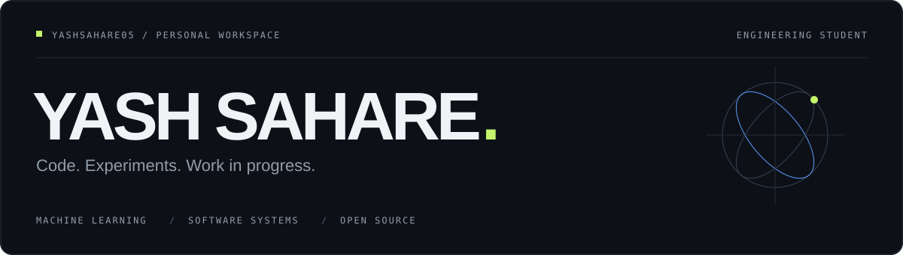

<!-- Upload this README and the included assets folder to the root of yashsahare05/yashsahare05. -->

<picture>
  <source media="(prefers-color-scheme: dark)" srcset="./assets/header-dark.svg">
  <source media="(prefers-color-scheme: light)" srcset="./assets/header-light.svg">
  
</picture>

 

  
  &nbsp;
  
  &nbsp;
  

 

Interested in how models learn, how software holds together, and where both break. Currently working through the fundamentals and getting more comfortable with real codebases.

 

### <samp>01 &nbsp; / &nbsp; ON MY DESK</samp>

<table>
<tr>
<td width="50%" valign="top">
LEARNING / EXPERIMENTING
<h3>Machine learning &amp; vision</h3>

Understanding the maths, implementing ideas, and experimenting with image-based systems.

<code>ML fundamentals</code> <code>Computer vision</code>

</td>
<td width="50%" valign="top">
BUILDING / UNDERSTANDING
<h3>Software &amp; systems</h3>

Practising algorithms, building APIs, and figuring out how larger codebases fit together.

<code>DSA</code> <code>Backend systems</code>

</td>
</tr>
</table>

 

### <samp>02 &nbsp; / &nbsp; WORKING TOOLBOX</samp>

Tools I use and tools I'm still getting comfortable with.

<table>
<tr>
<td width="50%" valign="top">
<h4>Languages</h4>
<picture>
  <source media="(prefers-color-scheme: light)" srcset="https://skillicons.dev/icons?i=python,cpp,ts,java&amp;theme=light">
  
</picture>

Python · C++ · TypeScript · Java

</td>
<td width="50%" valign="top">
<h4>Machine learning</h4>
<picture>
  <source media="(prefers-color-scheme: light)" srcset="https://skillicons.dev/icons?i=pytorch,opencv,sklearn&amp;theme=light">
  
</picture>

PyTorch · OpenCV · scikit-learn

</td>
</tr>
<tr>
<td width="50%" valign="top">
<h4>Web &amp; backend</h4>
<picture>
  <source media="(prefers-color-scheme: light)" srcset="https://skillicons.dev/icons?i=react,nextjs,fastapi,supabase,postgres&amp;theme=light">
  
</picture>

React · Next.js · FastAPI · Supabase · PostgreSQL

</td>
<td width="50%" valign="top">
<h4>Development environment</h4>
<picture>
  <source media="(prefers-color-scheme: light)" srcset="https://skillicons.dev/icons?i=git,docker,linux,vscode&amp;theme=light">
  
</picture>

Git · Docker · Linux · VS Code

</td>
</tr>
</table>

 

### <samp>03 &nbsp; / &nbsp; CODE IN PUBLIC</samp>

Reading code, tracing bugs, and making small contributions. Learning what it takes to get a change from a local fix to a useful pull request.

<a href="https://github.com/pulls?q=is%3Apr+author%3Ayashsahare05"><strong>Pull requests ↗</strong></a>
&nbsp;&nbsp; / &nbsp;&nbsp;
<a href="https://github.com/yashsahare05?tab=repositories">Repositories ↗</a>

<samp>EXPLORE BY CODEBASE</samp>

 

- [Supabase — my pull requests ↗](https://github.com/search?q=org%3Asupabase+author%3Ayashsahare05+is%3Apr&type=pullrequests)
- [TensorFlow — my pull requests ↗](https://github.com/search?q=org%3Atensorflow+author%3Ayashsahare05+is%3Apr&type=pullrequests)

  

---

 
<samp>STILL LEARNING. STILL BUILDING.</samp>
  
<a href="https://www.linkedin.com/in/yash-sahare-81b288355">LinkedIn</a>
&nbsp; / &nbsp;
<a href="https://x.com/yash_onx">X</a>
&nbsp; / &nbsp;
<a href="https://www.instagram.com/yashhh.s_">Instagram</a>
  
Yash Sahare · <a href="https://github.com/yashsahare05">@yashsahare05</a>

